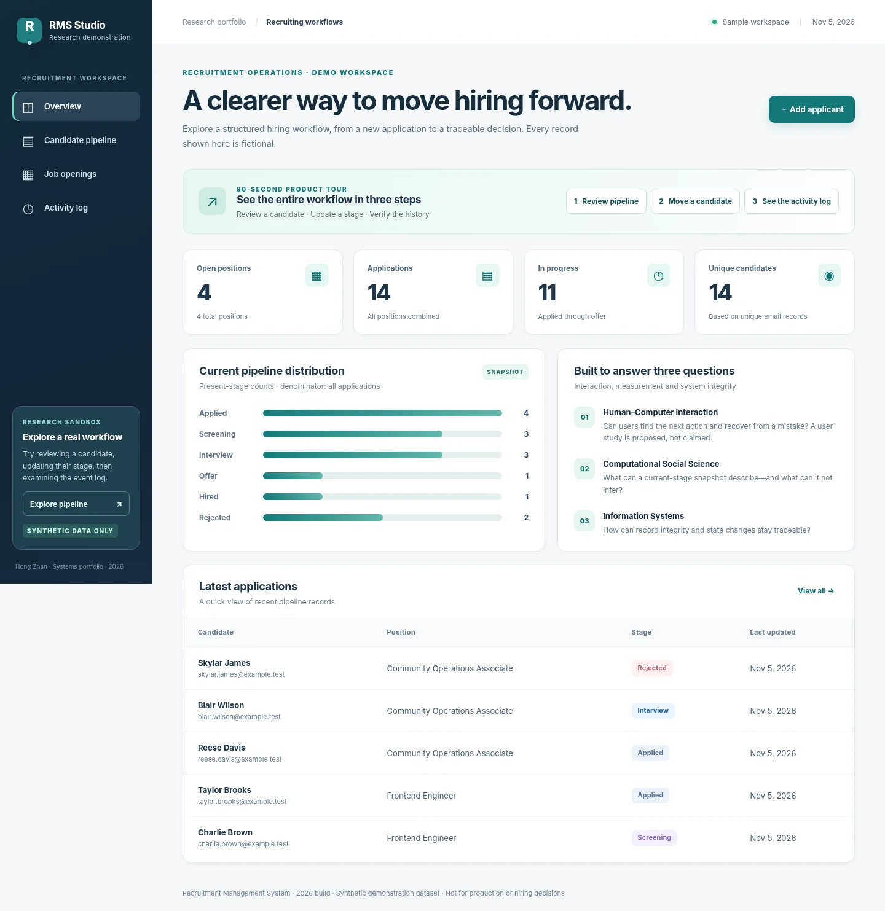

# Recruitment Management System

**2026 implementation: Java 21 + Spring Boot + Spring Data JPA + MySQL 8.4.** The browser UI and interaction design are carried forward from the supplied FastAPI project; the REST backend has been migrated and keeps the existing `/api/*` contract. The uploaded Python project remains available in the source archive and is recorded as the migration baseline.

This project is a demonstration, not a production ATS. All seeded names, emails, positions, counts, and activity are fictional synthetic records. Do not enter real applicant information: authentication and production privacy controls are not included.



## Run the full app

Requires Docker Desktop with Compose. From this directory:

```sh
docker compose up --build
```

Open <http://localhost:8000>. MySQL data is stored in a named volume and survives app restarts. To reset the local synthetic database, run `docker compose down -v` and start it again. To start empty, run `RMS_SEED_DEMO=false docker compose up --build`.

The default Compose credentials are for a local synthetic demo only. Override `MYSQL_PASSWORD` and `MYSQL_ROOT_PASSWORD` for a non-demo deployment. The service has no authentication and should not be exposed publicly with demo credentials.

## API and behavior

The static HTML/CSS/JavaScript frontend is served by Spring Boot. API paths and JSON fields remain compatible with the FastAPI version:

| Area | Routes |
|---|---|
| Health and descriptive metrics | `GET /api/health`, `GET /api/metrics` |
| Jobs | `GET/POST /api/jobs`, `PATCH /api/jobs/{id}/status` |
| Applications | `GET/POST /api/applications`, `GET /api/applications/{id}`, `PATCH /api/applications/{id}/stage` |
| Audit | `GET /api/audit?limit=40` |

Filtering accepts `search`, `job_id`, and `stage`. The workflow has six stages: `applied → screening → interview → offer → hired`, with `rejected` allowed from every active stage. Stage updates require `expected_version`; stale requests and invalid transitions return HTTP 409. Email is normalized case-insensitively; a candidate can apply to multiple jobs, but duplicate applications to one job are rejected. A closed job accepts no new applications. Accepted job/application changes create audit records in the same transaction.

## Architecture

```text
Existing browser UI (HTML / CSS / JS)
               │ same-origin REST
               ▼
Spring Boot REST controllers ── services/repositories (Spring Data JPA)
               │
               ├── Flyway versioned schema migration
               └── MySQL 8.4 (jobs, candidates, applications, audit_events)
```

Database constraints protect stage/status domains, normalized unique email, foreign keys, and one application per candidate/job. JPA optimistic locking backs the existing explicit application version. Migration files are in `src/main/resources/db/migration/`.

## Test and build

Requires Java 21, Maven 3.9+, and Docker for Testcontainers:

```sh
mvn verify
```

`RecruitmentApiIntegrationTest` starts a real MySQL 8.4 container and exercises seeded synthetic data, job/application creation, closed-job behavior, search, valid/invalid transitions, optimistic version conflicts, scoped histories, duplicate prevention, and audit persistence. CI runs the same command on GitHub Actions.

## Migration baseline and verification

The supplied FastAPI/SQLite source is retained under `legacy-fastapi/` and `README_FASTAPI_BASELINE.md`, separate from the runnable Java module. Before migration, its integration suite passed **15/15** under Python 3.14. The original UI files are copied unchanged to `src/main/resources/static/`; the UX screenshots and portfolio pages are retained.

The online portfolio Demo is a separate static GitHub Pages artifact. Its interactions use browser-local state that resets on reload; it is **not connected to this MySQL database** and is not a cloud-backed deployment. The public Demo is a UI preview only until it is deliberately connected to a deployed API.

## Academic and project context

The undergraduate project topic was a 2021 BEng graduation design. The current Java/Spring Boot/MySQL implementation is a new 2026 reconstruction and must not be described as recovered historical source. The supplied portfolio HTML is preserved in `portfolio/`; no user study or usability outcome is claimed.

## Repository contents

- `src/main/java`: API, persistence entities, repositories, frontend routes, synthetic seed
- `src/main/resources/db/migration`: Flyway schema
- `src/main/resources/static`: carried-forward recruitment UI
- `src/test/java`: MySQL Testcontainers integration tests
- `legacy-fastapi/`: retained pre-migration application and tests
- `portfolio/`: supplied three-direction research portfolio pages
- `docs/screenshots/`: supplied UX-reviewed UI screenshots
