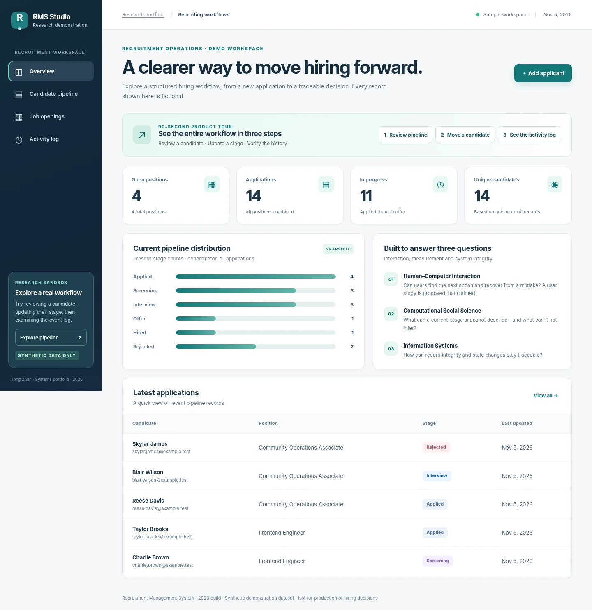
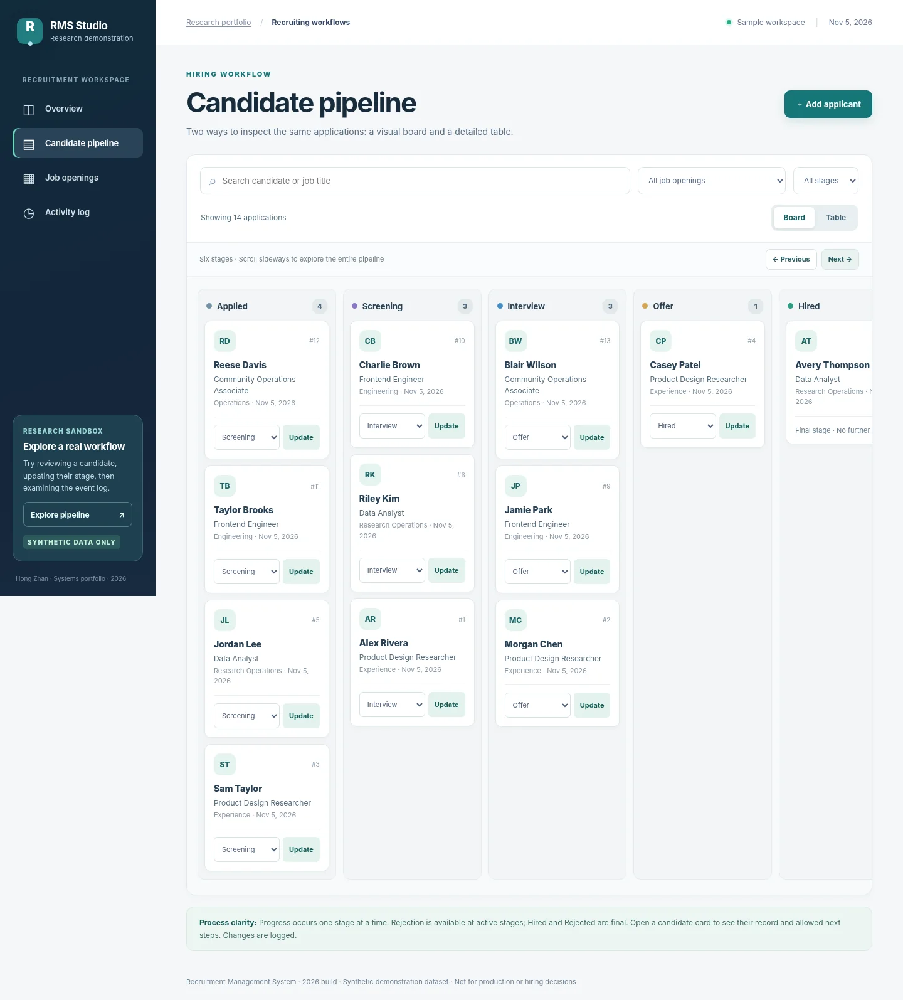

> **Historical FastAPI/SQLite baseline.** For the current Java/MySQL application, follow the [main README](README.md). To run the Python baseline, change to `legacy-fastapi/` before using the commands below. The 2026 reconstruction has no new participant study; the original 2021 capstone included think-aloud testing with 8 participants.

# Recruitment Management System

**An interactive research-portfolio web application for recruitment workflows.**<br>
Current implementation: **2026** · Undergraduate thesis topic explored: **2021**.

> **Synthetic demonstration:** Initial job titles, candidate names, emails, counts and pipeline statuses are fictional. They are not actual recruitment records, research observations or evidence of hiring outcomes. Use fictional records when experimenting with the interface.

## Start here — reviewer-friendly tour

**[Systems case study and walkthrough](portfolio/undergraduate.html)** · **[Design decisions and UX review](docs/UX_REVIEW_2026.md)** · **[System case study](portfolio/undergraduate.html)**



*Interface preview rendered in Chromium with synthetic FastAPI TestClient responses; not an externally deployed website screenshot.*

## Preview

The local app provides a recruiting workspace with four views: **Overview**, **Candidate pipeline**, **Job openings**, and **Activity log**. The candidate pipeline supports both a six-stage visual board and a searchable table; selecting a name opens its application history.



*The board scrolls sideways to show all six stages. All sample records are fictional.*

- Create a new job and close/reopen it to applications.
- Create a candidate application, search/filter existing applications, switch between visual board and table, inspect record details, and track stages.
- Advance applications only through permitted transitions, or reject from an active stage. Rejects invalid transitions and stale updates.
- Explore descriptively computed *current-stage* counts across synthetic records.
- Preserve changes in SQLite across browser refreshes and application restarts.
- Inspect application-specific histories and a database-backed activity log for accepted state changes.

The code in this repository was implemented in **2026**. No user-study results are attributed to it.

## Run locally

Requires **Python 3.10+**. No Node, npm, Docker or API keys required.

```bash
python3 -m venv .venv
source .venv/bin/activate       # Windows: .venv\Scripts\activate
pip install -r requirements.txt
python run.py
```

Open **http://127.0.0.1:8000**. API documentation: **http://127.0.0.1:8000/docs**.

By default the app creates `data/recruitment.db` with an initial synthetic demo dataset the first time it starts. It keeps subsequent edits; refreshing the browser does **not** clear changes. To reset the local synthetic dataset, stop the server, delete `data/recruitment.db`, and restart. To start with a completely empty dataset, set `RMS_SEED_DEMO=0` before starting. To choose a different local SQLite path, set `RMS_DB_PATH`.

```bash
RMS_SEED_DEMO=0 RMS_DB_PATH=/tmp/empty-recruitment.sqlite3 python run.py
```

**Note:** `run.py` binds to `127.0.0.1` only; do not make the current service internet-facing. The app has no authentication and is not configured for sensitive applicant data.

## Tests

```bash
python -m pytest -q
```

The test suite covers synthetic seeding, input validation, stage rules, stale-update rejection, duplicate applications, case-insensitive email reuse, closed-job constraints, search escape handling, audit records, and persistence after creating a new application instance. Each test uses an isolated temporary SQLite database. Integration tests can be run without a browser. An **optional**, independently replayable offline Chromium DOM smoke test is also included; it is not part of CI or a network E2E test:

```bash
pip install playwright
python -m playwright install chromium
python tools/offline_ui_check.py
```

This script operates through FastAPI `TestClient` and a browser test adapter; it does **not** contact a running local server.

## Architecture

```text
HTML / CSS / JavaScript
         |
     FastAPI REST
         |
       SQLite
  jobs | candidates | applications | audit_events
```

See [architecture, state transitions, data definitions, and research protocol](docs/ARCHITECTURE_AND_RESEARCH.md).

**Key API routes:** `GET /api/metrics`, `GET/POST /api/jobs`, `PATCH /api/jobs/{id}/status`, `GET/POST /api/applications`, `GET /api/applications/{id}`, `PATCH /api/applications/{id}/stage`, `GET /api/audit`, `GET /api/health`. OpenAPI schemas are available at `/openapi.json`.

## Integrated PhD research portfolio

The `portfolio/` directory is a **three-project, English-language research portfolio** that presents the MSc dissertation, the 2021 capstone topic / current system implementation, and the existing 2026 generative-AI trust study.

- **Research home:** `http://127.0.0.1:8000/portfolio/`
- **MSc dissertation case study:** `http://127.0.0.1:8000/portfolio/masters.html`
- **Recruitment system case study:** `http://127.0.0.1:8000/portfolio/undergraduate.html`
- **GenAI trust case study:** `http://127.0.0.1:8000/portfolio/genai.html`
- **Interactive recruitment application:** `http://127.0.0.1:8000/`

The static `portfolio/index.html` can also be opened directly to preview the case studies without starting Python; the recruitment application's interactive features **require** the server. The MSc case study describes my 2023 interview research; participant materials and the final dissertation are not distributed here. See `docs/master_dissertation/METHODS_AND_EVIDENCE.md` and the blank qualitative codebook template. The portfolio does not modify the separately hosted research repository.

## Connection to three doctoral research directions

- **HCI:** A human-readable workflow and interface artifact suitable for a future task-based usability evaluation. Interaction features exist; usability outcomes have **not** been measured.
- **Computational Social Science:** Clearly denominated descriptive metrics and explicit boundaries on what snapshots can explain. The dataset is synthetic; there are **no social-scientific findings**.
- **Information Systems:** End-to-end workflow modeling, normalized data entities, persistent state, transactionally recorded updates and version-controlled stage transitions.

For academically valid claims, see the [measurement definitions and proposed evaluation](docs/ARCHITECTURE_AND_RESEARCH.md). The app is not a real hiring platform and makes no automated candidate assessments.

## Project structure

```text
app/
  main.py             FastAPI endpoints and transition rules
  db.py               SQLite schema, transactions, synthetic seed
  static/
    polish.css        Readability and UX refinements
    index.html        Semantic page layout and forms
    styles.css        Responsive interface
    app.js            Browser API integration and interaction logic
run.py                Local application entry point
REVIEWER_START_HERE.md  Reviewer's 90-second verification path
tools/offline_ui_check.py  Optional offline browser DOM smoke test
tests/test_api.py      Automated API and portfolio integration tests
.github/workflows/     Continuous integration configuration (for future GitHub publication)
portfolio/             English-language three-project research showcase
docs/master_dissertation/  MSc methods/evidence note and blank codebook template
docs/                 Architecture, UX review, offline UI previews and follow-up
```

## Safety, data and rights

- Initial records are invented and use reserved `.test` email domains. They are not from the 2021 thesis, employers, participants, or public Reddit data.
- The current implementation has **no login/authorization, sensitive-data safeguards or verified compliance**; use only fictional information.
- This 2026 baseline includes no historical thesis files and has no new participant study; the 2021 capstone included testing with 8 participants.
- A public-use license has not been selected yet. Do not assume permission to reuse third-party historical project materials.

## Status

The revised interface has also been exercised in offline Chromium using a test adapter between UI `fetch` and the FastAPI TestClient. Candidate creation, search, stage change, history details, job creation, close job and activity views were exercised. The visual review at 1440px and 390px found no document-level horizontal overflow; the stage board intentionally scrolls within its panel. This is **not** a real-browser-to-server network test, a WCAG conformance audit, or a human-subject usability study. See [review notes](docs/UX_REVIEW_2026.md).

Core local workflows are implemented and covered by automated tests. External deployment, multi-user security, formal accessibility audit and any empirical user research are **not** complete. Additional work is needed before any production use; details are listed in the limitations above.
